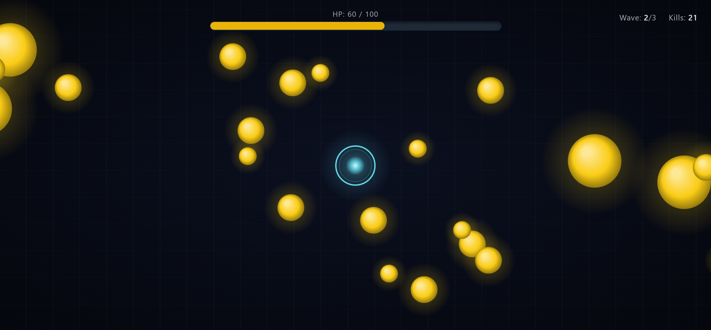

# Tower Defense

  

 

 

## Overview

**Tower Defense** is a local, offline tower defense web game built entirely from a single prompt (see [prompt.txt](./prompt.txt)). This repository showcases how different Large Language Models can generate a fully functional, zero-dependency browser game contained in **one `index.html` file**.

Each model receives the same prompt exactly once — no follow-up prompts are sent to fix problems or refine the result. The only freedom is that models may use tools (e.g., editing files and running code) while generating their implementation.

The prompt was run 10 times for each model, and one of those implementations lives in its own directory under [`models/`](./models).

## Game Features

- 🖱️ **Mouse-only controls**: click enemies before they reach the tower
- 🔊 **Web Audio API sound synthesis**: all sounds generated in code, no audio files
- ✨ **Custom particle effects**: pure Canvas 2D rendering
- 🎮 **Complete state machine**: Start → Playing → Intermission → Win / Lose

## Models

| Directory | Model | Parameters | Quantization | Size | Availability | Passed |
| --- | --- | --- | --- | --- | --- | --- |
| [`models/qwen3.8-27b/`](./models/qwen3.8-27b) | [Qwen3.8 27B](https://lmstudio.ai/models/qwen/qwen3.8-27b) | 27B | Q4_K_M | 17.7 GB | 💻 Local | ★★★⯪☆ (**7/10**) |
| [`models/qwen3.8-27b-gsq-rco/`](./models/qwen3.8-27b-gsq-rco) | [Qwen3.8 27B (GSQ RCO)](https://huggingface.co/ISTA-DASLab/Qwen3.8-27B-GSQ-RCO-GGUF) | 27B | IQ3_XXS | 11.4 GB | 💻 Local | ★★★☆☆ (**6/10**) |
| [`models/qwen3.5-9b/`](./models/qwen3.5-9b) | [Qwen3.5 9B](https://lmstudio.ai/models/qwen/qwen3.5-9b) | 9B | Q4_K_M | 6.5 GB | 💻 Local | ☆☆☆☆☆ (**0/10**) |

> **Note:** A run is marked as "Passed" when its generated game is fully playable in a browser. The column shows how many of each model's 10 runs passed.

## How to Play

1. Navigate into any of the model folders (e.g., `models/qwen3.8-27b/`).
2. Open the `index.html` file directly in any modern desktop browser (Chrome, Firefox, or Edge) — no local server, build step, or internet connection required.
